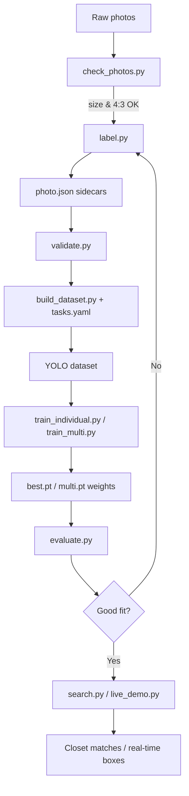
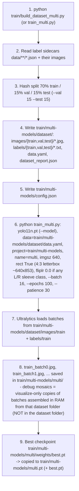
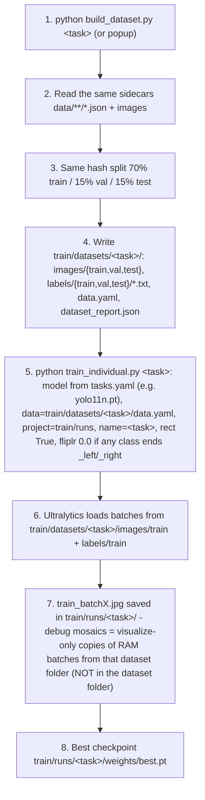

# FRA362-3 Group13 || Raja_fashion

**Find the same (or almost the same) clothes from your own closet given any fashion reference photo.**

A complete open-source pipeline:

1. **Annotate** – label tops & bottoms with detailed attributes (and left/right sleeves)
2. **Train** – progressive YOLO training (start with one attribute, then expand)
3. **Search** – detect attributes + dominant color → rank your closet items

---

## Why this design?

| Goal | Decision |
|------|----------|
| Easy progressive training | Attribute-specific boxes + `tasks.yaml` so you can train “crew vs not-crew” first |
| Friends can help label | Clean JSON sidecar + strict photo checker + detailed HOW_TO_LABEL.md |
| Low storage | Only images + small JSON (no huge annotation databases) |
| Real-world usable | Color matching (HSV + curated palette) + attribute matching |
| Familiar stack | Pure YOLO (Ultralytics) – detection or classification heads |

---

## Project structure

```
raja_fashion/
├── annotate/                  # Labeling tools (helpers will get this folder)
│   ├── check_photos.py        # Size + 4:3 ratio gate
│   ├── label.py               # Main labeling GUI
│   ├── validate.py            # Schema checker before you merge data
│   ├── HOW_TO_LABEL.md        # Detailed guide with examples
│   └── labeling_config/
│       └── schema.yaml        # Allowed classes & attributes
│
├── train/                     # Dataset building + YOLO training + evaluation
│   ├── tasks.yaml             # Progressive tasks (neck_crew, top_length, …)
│   ├── build_dataset.py       # JSON → YOLO dataset (detect or cls)
│   ├── train_individual.py    # One model per task (was train.py) – thin ultralytics wrapper
│   ├── train_multi.py         # One model for every attribute region (region_value classes)
│   ├── build_dataset_multi.py # Dataset-only helper for train_multi.py (no YOLO training)
│   ├── evaluate.py            # Single task OR selected models: accuracy, F1, consistency, diagnosis
│   ├── select_models.py       # Popup / CLI multi-model picker
│   ├── datasets/              # Generated (git-ignored)
│   ├── runs/                  # Per-task individual training outputs (git-ignored)
│   └── multi-models/          # Combined dataset, config.json and multi.pt (git-ignored)
│
├── search/                    # Inference + closet search + live demo
│   ├── search.py              # Reference photo → ranked closet matches
│   ├── live_demo.py           # Webcam real-time detection
│   └── color_detect.py        # HSV dominant-color extraction
│
├── data/                      # Your photos + closet database (not in git)
│   └── closet/                # Put labeled closet items here
│
├── requirements.txt
└── README.md                  # ← you are here
```

---

## How the pieces work together



---

## Quick start

```bash
# 1. Install
python -m venv .venv
source .venv/bin/activate          # Windows: .venv\Scripts\activate
pip install -r requirements.txt

# 2. Check photos before labeling
cd annotate
python check_photos.py ../data/my_photos

# 3. Label
python label.py ../data/my_photos

# 4. Validate
python validate.py ../data/my_photos

# 5. Build a first task (crew-neck detector)
cd ../train
python build_dataset.py neck_crew --data ../data

# 6. Train one task (individual model; popup picker if no task is given)
python train_individual.py neck_crew --epochs 80 --batch 16

# 6b. OR train ONE model that detects all labeled attribute regions at once
python train_multi.py --epochs 80 --batch 16

# 7. Diagnose one task
python evaluate.py neck_crew

# 7b. Diagnose the models you select (popup picker, all, or explicit list)
python evaluate.py
python evaluate.py --all
python evaluate.py --models neck_type,bottom_fit

# 8. Search your closet
cd ../search
python search.py path/to/reference.jpg --db ../data/closet

# 9. Live webcam test
python live_demo.py
```

### Training scripts and outputs

There are two ways to train:

- **`train_individual.py`** – the original behavior. Run it with no task to get
  the popup task picker, or pass one or more tasks from `tasks.yaml`
  (`--cli` skips the popup). Supports `--epochs`, `--batch`, `--patience`,
  `--imgsz`, `--model`, `--device` and `--square`. One YOLO model is trained
  per task; weights land in `train/runs/<task>/weights/best.pt`.
- **`train_multi.py`** – builds one combined detection dataset from every
  sidecar under `data/**/*.json` and trains a single YOLO model for all
  labeled regions in one pass. Classes are `<region>_<value>` strings such as
  `neck_crew`, `sleeve_left_long` and `bottom_fit_skinny`, derived from
  `schema.yaml`. It uses the shared hash-based split described in
  "Dataset split policy" below, so images never move between splits.
  Supports `--model` (default `yolo11n.pt`),
  `--epochs`, `--batch`, `--imgsz`, `--device`, `--patience`, `--square` and
  `--seed`. Final weights: `train/multi-models/multi.pt` (a copy of the
  Ultralytics `best.pt`, also kept at `train/multi-models/best.pt`).

Multi artifacts: `train/multi-models/dataset/data.yaml`,
`train/multi-models/dataset/dataset_report.json` (class names, image counts,
train instances) and `train/multi-models/config.json` (model, imgsz, classes,
regions). Add `--no-train` to only rebuild the dataset.

If you want to (re)build that combined dataset as a standalone step before
training, run `python build_dataset_multi.py` from `train/` (optionally with
`--data`, `--out`, `--val`, `--test`). It uses the same builder as
`train_multi.py` but performs no training, then prints the output paths and the
next command (`python train_multi.py`). This is equivalent to the `--no-train`
path; running `train_multi.py` later rebuilds the dataset and then trains.

Both scripts keep the 4:3 portrait letterbox (`rect=True`) by default;
`--square` disables it. Horizontal flip is disabled automatically when any
class involves left/right sleeves.

### Dataset split policy

Every dataset split in this project — per-task datasets from `build_dataset.py`, the
combined dataset built by `train_multi.py`, and the standalone `build_dataset_multi.py`
helper — uses **70% train / 15% validation / 15% test** by default. Assignment is
hash-based (SHA-1 of the image stem), so an image never moves between splits when more
data is added. To override the defaults, pass `--val` / `--test` to any of those three
scripts: train takes the remaining `100 - val - test` percent and `val + test` must stay
below 100. The effective percentages are recorded in each `dataset_report.json` under
`split_percent`.

### What `evaluate.py` reports

- **Accuracy** for classifiers, or **mAP50 / mAP50-95** for detectors.
- **Precision, recall, F1** overall and per class, with confusion matrix and
  95% Wilson confidence interval where applicable.
- **Consistency**: for detection models, the agreement between a matched
  prediction and the original JSON sidecar attribute value (with `tasks.yaml`
  aliases such as `off_shoulder → not_crew`). For classifiers, held-out accuracy.
- **Verdict** (`GOOD FIT` / `OVERFITTING` / `UNDERFITTING`) with reasons and
  suggestions, train↔val gap, small-sample warnings and curves.
- Evaluation plots the training metrics from `results.csv` to `results.jpg`
  alongside the CSV, while keeping the detailed evaluation curves in the
  `evaluation/` folder.

Outputs: `train/runs/evaluation_selected/report.json` and `report.md`, plus a
per-task `report_selected.json` inside each `train/runs/<task>/evaluation/`.
Both reports begin with a formula section documenting every metric used.

---

## Training flow (multi vs individual)

Both flows start from the same JSON sidecars and use the same hash-based **70% train / 15% val / 15% test** split, but they produce different datasets, checkpoints and `train_batchX` locations. The diagrams below trace each one end to end.

### Multi model (one model for every labeled region)



**Where next:** `python train_multi.py` leaves the best weights at `train/multi-models/multi/weights/best.pt`, copied to `train/multi-models/multi.pt` (and `best.pt`). Diagnose the model with `python evaluate.py multi` or `python evaluate.py --all`, then search with the popup picker, which offers both individual and multi models. The `train_batchX.jpg` files in `train/multi-models/multi/` are debugging mosaics only — the real data stays in `train/multi-models/dataset/`, so those files can be ignored or deleted.

### Individual models (old one-per-task flow)



**Where next:** `python train_individual.py <task>` leaves the best weights at `train/runs/<task>/weights/best.pt`. Diagnose the task with `python evaluate.py <task>` (or `python evaluate.py --models <task>`), then select that individual model in the search popup. The `train_batchX.jpg` files live in `train/runs/<task>/` and are debug mosaics only — training images actually come from `train/datasets/<task>/images/train` + `labels/train`.

---

## Labeling philosophy (important)

We do **not** put every attribute into one giant class name.  
Instead each visual region gets its own box:

| Region          | Attribute stored |
|-----------------|------------------|
| length          | regular / cropped |
| button          | none / half / down |
| neck            | crew / v / polo / … |
| pattern         | plain / graphic / … |
| sleeve_left     | short / long / … |
| sleeve_right    | short / long / … |

This makes progressive training trivial: a task only looks at the boxes that contain the attribute it cares about.

Left / right sleeves are **explicitly chosen by the labeler** (never guessed by position), so horizontal flip augmentation is automatically disabled when sleeve side matters.

---

## Tools & versions used

| Tool | Purpose | Docs |
|------|---------|------|
| **Ultralytics YOLO** (YOLOv8 / YOLO11 / YOLO26 when released) | Detection & classification | https://docs.ultralytics.com |
| **Pillow** | Image I/O, EXIF, padding | https://pillow.readthedocs.io |
| **OpenCV** | Webcam + drawing | https://docs.opencv.org |
| **PyYAML** | schema.yaml & tasks.yaml | https://pyyaml.org |
| **Matplotlib + Pandas** | Training curves & evaluation plots | – |
| **tkinter** | Zero-dependency labeling GUI | built into Python |

We intentionally stay on pure open-source packages so friends can run everything without accounts or paid services.

---

## Color detection formula

We convert RGB → HSV (OpenCV ranges: H ∈ [0,179], S,V ∈ [0,255]) then match against a curated palette of fashion-relevant named colors (navy, burgundy, beige, olive…).

For a pixel $(R,G,B)$:

$$
\begin{align*}
M &= \max(R,G,B),\quad m = \min(R,G,B)\\
V &= M\\
S &= \begin{cases}
0 & \text{if } M=0\\
\frac{M-m}{M} & \text{otherwise}
\end{cases}\\
H &= \begin{cases}
0° & \text{if } M=m\\
60° \times \frac{G-B}{M-m} \bmod 360° & \text{if } M=R\\
60° \times \frac{B-R}{M-m}+120° & \text{if } M=G\\
60° \times \frac{R-G}{M-m}+240° & \text{if } M=B
\end{cases}
\end{align*}
$$

Then H is scaled to $[0,179]$.  
A pixel is assigned to the palette entry whose HSV box contains it; the final dominant colors are the top-k names by pixel count.

Palette inspired by the widely-used [W3Schools color groups](https://www.w3schools.com/colors/colors_groups.asp) and CSS Color Module Level 4 named colors.

---

## Evaluation formulas (evaluate.py)

### Detection (mAP)

- **Precision** $= \frac{TP}{TP+FP}$
- **Recall** $= \frac{TP}{TP+FN}$
- **AP** = area under the precision-recall curve
- **mAP50-95** = mean AP over IoU thresholds 0.50 … 0.95 (step 0.05)

### Classification

- **Accuracy** $= \frac{\text{correct}}{N}$
- **95 % Wilson score interval** for accuracy $k/n$:

$$
\hat{p} = \frac{k}{n},\quad
z = 1.96,\quad
c = \frac{\hat{p}+\frac{z^2}{2n}}{1+\frac{z^2}{n}},\quad
h = \frac{z\sqrt{\frac{\hat{p}(1-\hat{p})}{n}+\frac{z^2}{4n^2}}}{1+\frac{z^2}{n}}
$$

Interval $= [c-h,\ c+h]$

### Overfitting / underfitting rules of thumb

| Condition | Verdict |
|-----------|---------|
| train_score − val_score > 0.15 (detect) or > 0.08 (cls) | OVERFITTING |
| both train & val scores low | UNDERFITTING |
| val loss bottoms early then rises while train loss keeps falling | OVERFITTING |
| otherwise | GOOD FIT |

These are heuristics, not statistical tests; always look at the sample sizes printed by `evaluate.py`.

---

## Progressive training workflow

1. Label only the **neck** region on ~200 images.
2. `python build_dataset.py neck_crew`
3. `python train_individual.py neck_crew` (or `python train_multi.py` for one all-region model)
4. `python evaluate.py neck_crew`
5. If the model is healthy, expand labeling to length, sleeves, etc. and add new tasks in `tasks.yaml`.

Because every attribute lives in its own box, adding a new attribute never invalidates old labels.

---

## Sending data to the project owner

Friends should only send:

```
friend_name/
├── img001.jpg
├── img001.json
├── img002.jpg
├── img002.json
└── …
```

Zip it and share. The owner runs `validate.py` then merges into the central `data/` folder.

---

## License & credits

- Code: MIT (or whatever the group decides)
- YOLO: Ultralytics AGPL-3.0 (or Enterprise)
- Color palette: public domain / CSS named colors

Happy labeling & searching!
