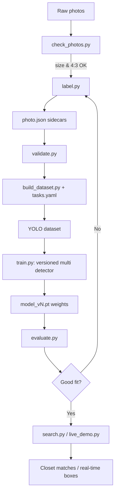
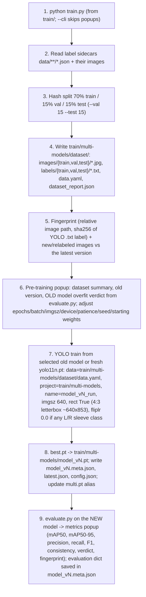

# FRA362-3 Group13 || Raja_fashion

**Find the same (or almost the same) clothes from your own closet given any fashion reference photo.**

A complete open-source pipeline:

1. **Annotate** – label tops & bottoms with detailed attributes (and left/right sleeves)
2. **Train** – one versioned YOLO detector for every labeled attribute region (`python train.py`)
3. **Search** – detect attributes + dominant color → rank your closet items

---

## Why this design?

| Goal | Decision |
|------|----------|
| Easy progressive training | Attribute-specific boxes: each training run adds classes to the next versioned model |
| Friends can help label | Clean JSON sidecar + strict photo checker + detailed HOW_TO_LABEL.md |
| Low storage | Only images + small JSON (no huge annotation databases) |
| Real-world usable | Color matching (HSV + curated palette) + attribute matching |
| Familiar stack | Pure YOLO (Ultralytics) – detection or classification heads |

---

## Project structure

```
raja_fashion/
├── annotate/                  # Labeling tools (helpers will get this folder)
│   ├── check_photos.py        # Size + 4:3 ratio gate
│   ├── label.py               # Main labeling GUI
│   ├── validate.py            # Schema checker before you merge data
│   ├── HOW_TO_LABEL.md        # Detailed guide with examples
│   └── labeling_config/
│       └── schema.yaml        # Allowed classes & attributes
│
├── train/                     # Dataset building + YOLO training + evaluation + prediction
│   ├── tasks.yaml             # Legacy per-task definitions (individual models)
│   ├── build_dataset.py       # ONLY dataset builder: JSON → shared 70/15/15 YOLO dataset
│   ├── train.py               # ONLY trainer: dataset build + versioned multi-attribute YOLO
│   ├── evaluate.py            # Model picker + accuracy/F1/consistency/verdict reports
│   ├── predict_image.py       # GUI: upload a photo → boxes + labelled confidence panel
│   ├── select_models.py       # Shared popup / CLI model picker
│   ├── datasets/              # Legacy per-task datasets (git-ignored)
│   ├── runs/                  # Ultralytics/evaluation outputs (git-ignored)
│   └── multi-models/          # dataset/, model_vN.pt + model_vN.meta.json,
│                              # latest.json, config.json, multi.pt alias (git-ignored)
│
├── search/                    # Inference + closet search + live demo
│   ├── search.py              # Reference photo → ranked closet matches
│   ├── live_demo.py           # Webcam real-time detection
│   └── color_detect.py        # HSV dominant-color extraction
│
├── data/                      # Your photos + closet database (not in git)
│   └── closet/                # Put labeled closet items here
│
├── requirements.txt
└── README.md                  # ← you are here
```

**One script per job.** `build_dataset.py` is the only dataset builder,
`train.py` is the only trainer, `evaluate.py` is the only evaluator and
`predict_image.py` is the photo GUI. The old `prepare_data.py` and
`build_dataset_multi.py` helpers were **removed**; their functionality lives in
`build_dataset.py` (which exposes `build_multi_dataset` / `SCHEMA_PATH`).

---

## How the pieces work together



---

## Quick start

```bash
# 1. Install
python -m venv .venv
source .venv/bin/activate          # Windows: .venv\Scripts\activate
pip install -r requirements.txt

# 2. Check photos before labeling
cd annotate
python check_photos.py ../data/my_photos

# 3. Label
python label.py ../data/my_photos

# 4. Validate
python validate.py ../data/my_photos

# 5. Train ONE model for every labeled attribute region.
#    The dataset is rebuilt automatically; a popup shows the dataset summary and
#    the OLD model's overfit report before training.
cd ../train
python train.py --epochs 80 --batch 16

# 5b. (optional) refresh the shared 70/15/15 dataset without training
python build_dataset.py

# 6. Diagnose the latest version (also run automatically after training)
python evaluate.py multi

# 6b. Diagnose the models you select (popup picker, all, or explicit list).
#     With no arguments a multi-select popup lists individual, versioned and
#     legacy-multi weights; the held-out split is TEST by default.
python evaluate.py
python evaluate.py --all
python evaluate.py --models model_v1,model_v0 --split test
python evaluate.py --cli                 # list available models, no GUI

# 7. Test a photo in the GUI: "Upload picture…" (top-left) + model picker.
#    Detected labels, confidence and weights appear in the results panel.
python predict_image.py
#    CLI equivalent: python predict_image.py photo.jpg --weights multi-models/multi.pt

# 8. Search your closet
cd ../search
python search.py path/to/reference.jpg --db ../data/closet

# 9. Live webcam test
python live_demo.py
```

### Training scripts and outputs

There is **one** trainer: **`python train.py`** from `train/`. There is no
separate individual-training path. Each run rebuilds the combined detection
dataset from every sidecar under `data/**/*.json` and trains one YOLO model for
all labeled regions in one pass. Classes are `<region>_<value>` strings such as
`neck_crew`, `sleeve_left_long` and `bottom_fit_skinny`, derived from
`schema.yaml`. Training always uses the **full current dataset**.

**Versioned output** (all under `train/multi-models/`):

- `model_vN.pt` – weights for version N, starting at `model_v0.pt`.
- `model_vN.meta.json` – `version`, relative `weights` path, `classes`, `regions`,
  `fingerprint` + `fingerprint_entries`, `trained_at`, `base_model`, `params`
  and `evaluation` (filled in after the post-training evaluation).
- `model_vN_run/` – Ultralytics run (`results.csv`, `weights/best.pt`, plots).
- `latest.json` – `{"latest": "model_vN"}` for the newest version.
- `config.json` – compatibility pointer to the latest version's metadata, read
  by `evaluate.py`. `multi.pt` / `best.pt` are aliases of the latest weights so
  `select_models.py` and `python evaluate.py multi` keep working.
- `dataset/data.yaml` and `dataset/dataset_report.json` – classes, image counts
  and train instances from the shared 70/15/15 hash split.

**Before training**, a tkinter popup shows the current dataset summary (class
count, train/val/test image counts, new and relabeled images versus the latest
fingerprint), the old model version and an **overfit / no-overfit verdict for
that old model on the current dataset** computed by `evaluate.py` (shown as
`n/a` if evaluation fails). The popup lets you change `epochs`, `batch`,
`imgsz`, `device`, `patience`, `seed` and the starting weights (any old
`model_vN` or **fresh base**), then press **Train** or **Cancel**. After
training, a second popup shows mAP50, mAP50-95, precision, recall, F1,
consistency, verdict and the dataset fingerprint; **OK** closes it.

Headless / scripted runs: add `--cli` (alias `--yes`) to skip both popups; the
same fields are available as CLI flags (`--epochs`, `--batch`, `--imgsz`,
`--device`, `--patience`, `--seed`, `--version`, `--fresh`/`--scratch`,
`--init PATH`, `--square`, `--split`, `--data`, `--out`, `--val`, `--test`,
`--model`). With no versions yet, the fresh base (`yolo11n.pt` by default)
produces `model_v0.pt`; otherwise the latest version is selected by default and
the new run becomes `model_vN+1`. The 4:3 portrait letterbox (`rect=True`) is
the default; `--square` disables it. Horizontal flip is disabled automatically
when any left/right sleeve class is present.

The only dataset builder is `python build_dataset.py` (from `train/`). It writes
`multi-models/dataset/` and exposes `build_multi_dataset` / `SCHEMA_PATH` for
`train.py`; no YOLO is needed just to rebuild the data. `train.py` also rebuilds
`dataset/` on every run before training (`--data`, `--out`, `--val`, `--test`
override the defaults). `prepare_data.py` and `build_dataset_multi.py` have been
removed — do not call them.

Standalone diagnosis still works: `python evaluate.py` opens a multi-select
model picker; `python evaluate.py multi`, `--models ...` and `--all` cover the
scripted paths. It reads `config.json`, the `multi.pt` alias and `dataset/` for
legacy/versioned models; the trainer calls the same `evaluate.py` functions
itself. The held-out split is **test** unless `--split val` is given.

### Dataset split policy

Every dataset split in this project — the shared dataset built by
`build_dataset.py` and reused by `train.py` — uses
**70% train / 15% validation / 15% test** by default. Assignment is hash-based
(SHA-1 of the image stem), so an image never moves between splits when more data is
added. To override the defaults, pass `--val` / `--test` to `train.py` (or
`build_dataset.py`): train takes the remaining `100 - val - test` percent and
`val + test` must stay below 100. The effective percentages are recorded in each
`dataset_report.json` under `split_percent`.

### What `evaluate.py` reports

- **Accuracy** for classifiers, or **mAP50 / mAP50-95** for detectors.
- **Precision, recall, F1** overall and per class, with confusion matrix and
  95% Wilson confidence interval where applicable.
- **Consistency**: for detection models, the agreement between a matched
  prediction and the original JSON sidecar attribute value (with `tasks.yaml`
  aliases such as `off_shoulder → not_crew`). For classifiers, held-out accuracy.
- **Verdict** (`GOOD FIT` / `OVERFITTING` / `UNDERFITTING`) with reasons and
  suggestions, train↔val gap, small-sample warnings and curves.
- Evaluation plots the training metrics from `results.csv` to `results.jpg`
  alongside the CSV, while keeping the detailed evaluation curves in the
  `evaluation/` folder.

**Clean report layout:** every report starts with the formula section. The
selected-model `report.md` then opens with a compact summary table —
**Model | Split | mAP50 / accuracy | F1 | Consistency | Verdict** — followed by
one section per model with a per-class table (precision, recall, F1 and, for
detectors, mAP50 / mAP50-95), reasons, suggestions and data warnings. The console
prints the same one-line-per-model summary when evaluation finishes. The
held-out split defaults to **test** (`--split val` overrides it; empty test
folders fall back to val and are recorded in the JSON).

Outputs: `train/runs/evaluation_selected/report.json` and `report.md`, plus a
per-model `report_selected.json` inside each `train/runs/<model>/evaluation/`.
Both reports begin with a formula section documenting every metric used.

### Photo prediction GUI (`predict_image.py`)

`python predict_image.py` (from `train/`) opens a tkinter window. The
**"Upload picture…"** button is at the top-left; a dropdown lists every trained
model (individual, versioned and legacy multi) and **"Choose models…"** opens
the shared `select_models` picker for multi-select. Picking a picture runs the
selected model(s) immediately: numbered boxes are drawn on the photo and the
results panel lists each detected class, confidence and the weights that made
it. The annotated image is saved under `project/predicts/`; no tokens or
secrets are logged.

Headless mode is unchanged, e.g. `python predict_image.py photo.jpg --weights
multi-models/multi.pt --conf 0.25 --save out.jpg`.

---

## Training flow (one versioned multi model)

One flow only: `python train.py` reads the JSON sidecars, builds the dataset with the
same hash-based **70% train / 15% val / 15% test** split, reviews the old model,
then writes a new version.



**Where next:** diagnose again any time with `python evaluate.py multi` (or
`python evaluate.py --all`) from `train/` — `config.json` points at the latest
version's metadata. The `train_batchX.jpg` files in `train/multi-models/model_vN_run/`
are debugging mosaics only; the real data stays in `train/multi-models/dataset/`.
To continue training, simply run `python train.py` again: it picks the latest
version by default and writes `model_v(N+1)`.

---

## Labeling philosophy (important)

We do **not** put every attribute into one giant class name.  
Instead each visual region gets its own box:

| Region          | Attribute stored |
|-----------------|------------------|
| length          | regular / cropped |
| button          | none / half / down |
| neck            | crew / v / polo / … |
| pattern         | plain / graphic / … |
| sleeve_left     | short / long / … |
| sleeve_right    | short / long / … |

This makes progressive training trivial: adding attributes adds new `<region>_<value>`
classes to the next version of the single model, without invalidating old labels.

Left / right sleeves are **explicitly chosen by the labeler** (never guessed by position), so horizontal flip augmentation is automatically disabled when sleeve side matters.

---

## Tools & versions used

| Tool | Purpose | Docs |
|------|---------|------|
| **Ultralytics YOLO** (YOLOv8 / YOLO11 / YOLO26 when released) | Detection & classification | https://docs.ultralytics.com |
| **Pillow** | Image I/O, EXIF, padding | https://pillow.readthedocs.io |
| **OpenCV** | Webcam + drawing | https://docs.opencv.org |
| **PyYAML** | schema.yaml & tasks.yaml | https://pyyaml.org |
| **Matplotlib + Pandas** | Training curves & evaluation plots | – |
| **tkinter** | Zero-dependency labeling GUI | built into Python |

We intentionally stay on pure open-source packages so friends can run everything without accounts or paid services.

---

## Color detection formula

We convert RGB → HSV (OpenCV ranges: H ∈ [0,179], S,V ∈ [0,255]) then match against a curated palette of fashion-relevant named colors (navy, burgundy, beige, olive…).

For a pixel $(R,G,B)$:

$$
\begin{align*}
M &= \max(R,G,B),\quad m = \min(R,G,B)\\
V &= M\\
S &= \begin{cases}
0 & \text{if } M=0\\
\frac{M-m}{M} & \text{otherwise}
\end{cases}\\
H &= \begin{cases}
0° & \text{if } M=m\\
60° \times \frac{G-B}{M-m} \bmod 360° & \text{if } M=R\\
60° \times \frac{B-R}{M-m}+120° & \text{if } M=G\\
60° \times \frac{R-G}{M-m}+240° & \text{if } M=B
\end{cases}
\end{align*}
$$

Then H is scaled to $[0,179]$.  
A pixel is assigned to the palette entry whose HSV box contains it; the final dominant colors are the top-k names by pixel count.

Palette inspired by the widely-used [W3Schools color groups](https://www.w3schools.com/colors/colors_groups.asp) and CSS Color Module Level 4 named colors.

---

## Evaluation formulas (evaluate.py)

### Detection (mAP)

- **Precision** $= \frac{TP}{TP+FP}$
- **Recall** $= \frac{TP}{TP+FN}$
- **AP** = area under the precision-recall curve
- **mAP50-95** = mean AP over IoU thresholds 0.50 … 0.95 (step 0.05)

### Classification

- **Accuracy** $= \frac{\text{correct}}{N}$
- **95 % Wilson score interval** for accuracy $k/n$:

$$
\hat{p} = \frac{k}{n},\quad
z = 1.96,\quad
c = \frac{\hat{p}+\frac{z^2}{2n}}{1+\frac{z^2}{n}},\quad
h = \frac{z\sqrt{\frac{\hat{p}(1-\hat{p})}{n}+\frac{z^2}{4n^2}}}{1+\frac{z^2}{n}}
$$

Interval $= [c-h,\ c+h]$

### Overfitting / underfitting rules of thumb

| Condition | Verdict |
|-----------|---------|
| train_score − val_score > 0.15 (detect) or > 0.08 (cls) | OVERFITTING |
| both train & val scores low | UNDERFITTING |
| val loss bottoms early then rises while train loss keeps falling | OVERFITTING |
| otherwise | GOOD FIT |

These are heuristics, not statistical tests; always look at the sample sizes printed by `evaluate.py`.

---

## Progressive training workflow

1. Label only the **neck** region on ~200 images.
2. `cd train && python train.py` — creates `model_v0.pt` (fresh base) with a
   dataset summary and an `n/a` old-model report in the pre-training popup.
3. `python evaluate.py multi` for a standalone diagnosis at any time.
4. If the model is healthy, expand labeling to length, sleeves, etc. and run
   `python train.py` again — the popup now shows the old version's overfit
   verdict and the new/relabeled image counts; the result is `model_v1.pt`.
5. Repeat: each run continues from the latest version (or your chosen one) and
   increments the version number.

Because every attribute lives in its own box, adding a new attribute never invalidates old labels.

---

## Sending data to the project owner

Friends should only send:

```
friend_name/
├── img001.jpg
├── img001.json
├── img002.jpg
├── img002.json
└── …
```

Zip it and share. The owner runs `validate.py` then merges into the central `data/` folder.

---

## License & credits

- Code: MIT (or whatever the group decides)
- YOLO: Ultralytics AGPL-3.0 (or Enterprise)
- Color palette: public domain / CSS named colors

Happy labeling & searching!
